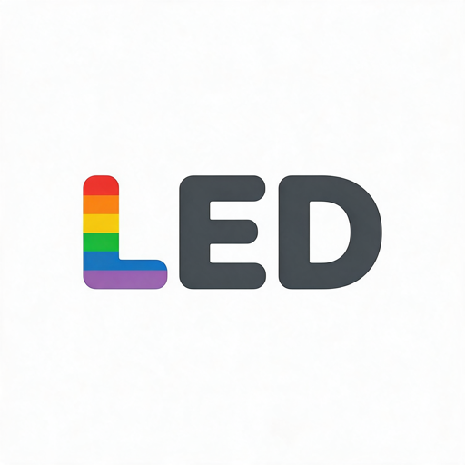
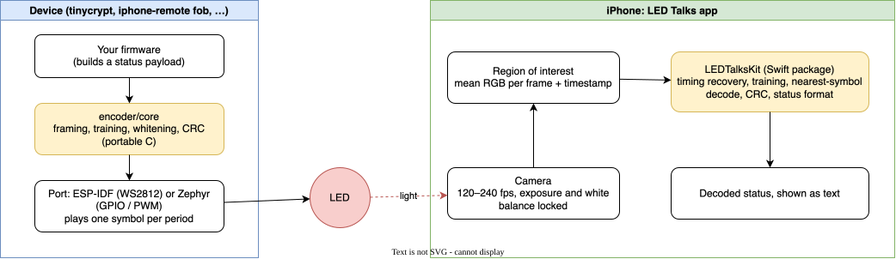

# LED Talks: devices that blink their status at your phone

A device blinks its status LED; you point an iPhone at it, and the phone reads what it says. No
radio, no pairing, no cable: just light and a camera.

## Support

If you find this useful, please consider buying me a coffee:

[](https://www.paypal.com/donate?hosted_button_id=Q3BESC73EWVNN&custom=led-talks)

## About the name

"LED Talks" is a silly pun on [TED Talks](https://www.ted.com/): here, the LEDs do the talking.
This project is **not in any way affiliated with, endorsed by, or connected to TED** or TED
Conferences LLC. It's just a pun, so please don't sue me.

## Table of Contents

<!-- toc -->

- [What it does](#what-it-does)
- [Architecture Diagram](#architecture-diagram)
- [Repository Layout](#repository-layout)
- [Testing](#testing)
- [Architecture Diagrams](#architecture-diagrams)
- [Support](#support)

<!-- tocstop -->

## What it does

- **On the device**, a small C library turns bytes (usually a status report) into a sequence of
  LED symbols, and a port plays them on the LED:
  - a plain LED, switched on and off, or at four brightness levels with PWM;
  - an RGB LED, such as a WS2812, in eight colours.
- **On the phone**, the LED Talks app films the LED at up to 240 frames a second, with exposure
  and white balance locked, and decodes what it sees.
- Every message starts with a **training sequence**: the device shows each of its symbols once,
  in a known order, and the phone learns what each looks like through this lens, in this light.
  So the decoder copes with odd LEDs, odd cameras, and odd rooms.
- The usual payload is a **status report**: device, firmware version, uptime, battery, and
  device-specific fields, which the app shows as readable text.

Rough data rates, at 240 fps, after framing: about 50 bps for on/off, 150 bps for four
brightness levels, and 200 bps for eight colours. A 32-byte status takes a couple of seconds.
The protocol is in [docs/protocol.md](docs/protocol.md).

## Architecture Diagram



## Repository Layout

| Path | What |
|---|---|
| `docs/protocol.md` | The over-the-light protocol, with test vectors |
| `encoder/core/` | The portable C encoder and status-report builder, with host tests |
| `encoder/esp-idf/` | ESP-IDF component: plays messages on a WS2812 (or a plain GPIO LED) |
| `encoder/zephyr/` | Zephyr module: plays messages on a GPIO or PWM LED |
| `reader/LEDTalksKit/` | Swift package: decoder, status format, and a synthetic camera for tests |
| `reader/app/` | The LED Talks iOS app (SwiftUI; the Xcode project is generated by XcodeGen) |

## Testing

```sh
make -C encoder/core/tests test          # C encoder against the protocol's test vectors
(cd reader/LEDTalksKit && swift test)    # decoder, end to end through the synthetic camera
```

## Architecture Diagrams

`docs/architecture/led-talks.drawio` is the source for the diagram above.
The SVG is auto-regenerated on commit by the pre-commit hook in `.githooks/pre-commit`.

To activate the hook after cloning:

```bash
git config core.hooksPath .githooks
```

## Support

If you find this useful, please consider buying me a coffee:

[](https://www.paypal.com/donate?hosted_button_id=Q3BESC73EWVNN&custom=led-talks)
